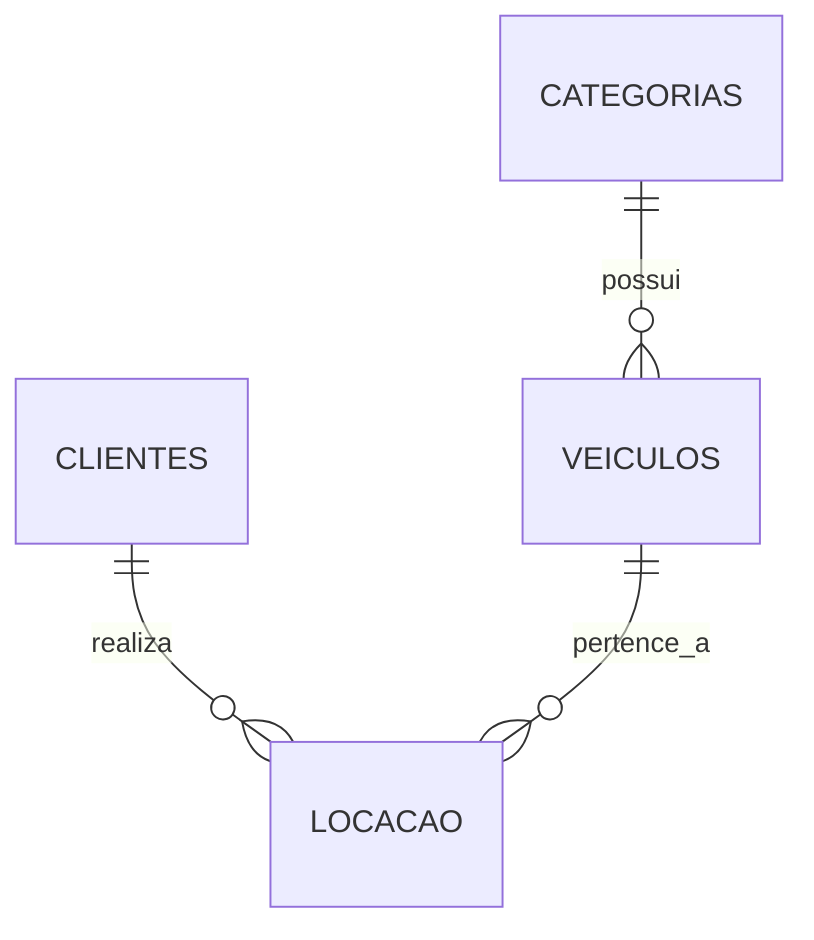

# 🚗 DriveEasy — Sistema de Gestão de Locação de Veículos

<div align="center">

  
  
  
  
  

  <p align="center">
    <b>Documentação Técnica, Modelagem de Banco de Dados Relacional e Portal Web da DriveEasy Locadora de Automóveis.</b>
  </p>

</div>

---

## 📌 Sumário

- [Visão Geral](#-visão-geral)
- [Problemas Operacionais Solucionados](#-problemas-operacionais-solucionados)
- [Tecnologias Utilizadas](#-tecnologias-utilizadas)
- [Arquitetura do Banco de Dados](#-arquitetura-do-banco-de-dados)
- [Normalização (1FN a 4FN)](#-normalização-1fn-a-4fn)
- [Consultas SQL Analíticas](#-consultas-sql-analíticas)
- [Portal de Documentação Web](#-portal-de-documentação-web)
- [Estrutura do Repositório](#-estrutura-do-repositório)
- [Como Executar o Projeto](#-como-executar-o-projeto)
- [Autor e Licença](#-autor-e-licença)

---

## 📑 Visão Geral

A **DriveEasy** é uma empresa de locação de veículos automotores que atende clientes corporativos e individuais com uma frota variada (Econômicos, SUVs, Executivos e Utilitários).

Este repositório contém a solução completa para o sistema de gestão da empresa, englobando:
1. **Modelagem e Scripts SQL** (`DDL`, `DML` e `Queries`) para o SGBD **MySQL 8.0**.
2. **Página Web de Documentação Técnica** desenvolvida em **HTML5 e CSS3** semânticos.
3. **Backup Completo (`Dump`)** pronto para hospedagem na nuvem.

---

## 🛠️ Problemas Operacionais Solucionados

Antes do banco de dados relacional, a operação sofria com dados descentralizados. A nova modelagem elimina:

* 🚫 **Overbooking de Veículos:** Restrições de chave e validações impedem reservas duplas do mesmo veículo no mesmo período.
* 🚫 **Inconsistência na Gestão de Multas:** Mapeamento direto entre o veículo, a data/hora da locação e o cliente condutor.
* 🚫 **Falha no Histórico de Manutenção:** Registro centralizado de quilometragem e estado operacional da frota.
* 🚫 **Redundância Cadastral:** Endereços atômicos e separação de categorias eliminam duplicações de dados.

---

## 💻 Tecnologias Utilizadas

* **SGBD:** MySQL 8.0 (Engine `InnoDB` com suporte a transações e *Foreign Keys*)
* **Hospedagem Cloud:** Aiven Cloud MySQL
* **Front-end Web:** HTML5 Semântico & CSS3 com Variáveis Globais
* **Ferramentas de Design & SQL:** MySQL Workbench, DBeaver, VS Code

---

## 🗄️ Arquitetura do Banco de Dados

O banco de dados `sistema_aluguel_veiculos` foi modelado com as seguintes tabelas e regras de integridade referencial:



### Dicionário de Dados Resumido

#### 1. `categorias`
Armazena os tipos de veículos e o custo base das diárias.
* `id_categoria` (INT, PK, AUTO_INCREMENT)
* `nome_categoria` (VARCHAR, UNIQUE, NOT NULL)
* `descricao` (VARCHAR, NOT NULL)
* `valor_diaria` (DECIMAL, CHECK > 0)

#### 2. `clientes`
Armazena o cadastro atômico dos clientes contratantes.
* `id_cliente` (INT, PK, AUTO_INCREMENT)
* `nome_cliente` (VARCHAR, NOT NULL)
* `cpf` (CHAR(11), UNIQUE, NOT NULL)
* `cnh` (VARCHAR, UNIQUE, NOT NULL)
* `email` (VARCHAR, UNIQUE, NOT NULL)
* `logradouro`, `numero`, `bairro`, `cidade`, `estado`, `cep` (Atributos de Endereço)

#### 3. `veiculos`
Armazena a frota de automóveis da locadora.
* `id_veiculo` (INT, PK, AUTO_INCREMENT)
* `placa` (VARCHAR(8), UNIQUE, NOT NULL)
* `renavam`, `chassi` (VARCHAR, UNIQUE, NOT NULL)
* `km` (INT, CHECK >= 0)
* `status` (ENUM: 'disponivel', 'locado', 'manutencao', 'inativo')
* `id_categoria` (INT, FK -> categorias.id_categoria)

#### 4. `locacao`
Registra os contratos de aluguel e controle temporais.
* `id_locacao` (INT, PK, AUTO_INCREMENT)
* `id_cliente` (INT, FK -> clientes.id_cliente)
* `id_veiculo` (INT, FK -> veiculos.id_veiculo)
* `data_retirada` (DATETIME, NOT NULL)
* `data_prevista_devolucao` (DATETIME, CHECK >= data_retirada)
* `valor_total` (DECIMAL, CHECK >= 0)
* `status` (ENUM: 'ativa', 'concluida', 'cancelada')

---

## 📐 Normalização (1FN a 4FN)

1. **1ª Forma Normal (1FN):** Todos os campos contêm valores atômicos (endereço fracionado em colunas independentes).
2. **2ª Forma Normal (2FN):** Chaves Primárias simples e autoincrementadas (`AUTO_INCREMENT`), sem dependências parciais.
3. **3ª Forma Normal (3FN):** Separação de atributos transitivos; `valor_diaria` reside apenas na tabela `categorias`.
4. **4FN:** Eliminação de dependências multivaloradas através de isolamento de tabelas associativas secundárias.

---

## 🔍 Consultas SQL Analíticas

O projeto dispõe de consultas otimizadas para inteligência de negócios. Exemplo:

```sql
-- Faturamento Total por Categoria de Veículo
SELECT 
    cat.nome_categoria,
    COUNT(l.id_locacao) AS total_locacoes,
    SUM(l.valor_total) AS faturamento_total
FROM locacao l
INNER JOIN veiculos v ON l.id_veiculo = v.id_veiculo
INNER JOIN categorias cat ON v.id_categoria = cat.id_categoria
WHERE l.status = 'concluida'
GROUP BY cat.nome_categoria
ORDER BY faturamento_total DESC;
```

---

## 🌐 Portal de Documentação Web

Para além dos scripts SQL, o repositório inclui um **Portal Web Técnico** estático (`index.html` e `style.css`) construído com uma paleta de cores em **Roxo, Azul e Branco**.

### Características do Site:
* **Design Responsivo:** Adaptado para Mobile, Tablet e Desktop.
* **Leitura Clara:** Formatação de código SQL e tabelas interativas de dicionário de dados.
* **Navegação Fixa:** Acesso rápido às seções do projeto.

---

## 📁 Estrutura do Repositório

```text
driveeasy-database/
├── sql/
│   ├── 01_criacao_banco.sql                # DDL - Tabelas e Restrições
│   ├── 02_povoamento.sql                   # DML - Inserção de Dados Fictícios
│   ├── 03_consultas.sql                    # Queries Analíticas
│   └── dump_sistema_aluguel_veiculos.sql   # Dump Completo para Hospedagem
├── docs/
│   ├── index.html                          # Site da Documentação
│   └── style.css                           # Estilos CSS (Roxo, Azul e Branco)
├── der/
│   └── modelo_logico.png                   # Diagrama de Entidade-Relacionamento
└── README.md                               # Este arquivo
```

---

## 🚀 Como Executar o Projeto

### 1. Executar o Banco de Dados Localmente
1. Abra o seu SGBD MySQL (ex: MySQL Workbench).
2. Importe e execute os arquivos na ordem:
   ```bash
   01_criacao_banco.sql -> 02_povoamento.sql -> 03_consultas.sql
   ```

### 2. Importar o Dump no Aiven / Nuvem
Para restaurar a base completa na nuvem Aiven via terminal:
```bash
mysql -h <HOST_AIVEN> -P <PORTA> -u <USUARIO> -p < sql/dump_sistema_aluguel_veiculos.sql
```

### 3. Visualizar o Portal Web
Basta abrir o arquivo `docs/index.html` em qualquer navegador ou ativar o **GitHub Pages** apontando para a pasta `/docs`.

---

<div align="center">
  <p>Desenvolvido para a Atividade IV — Banco de Dados Relacional (BCD)</p>
</div>
